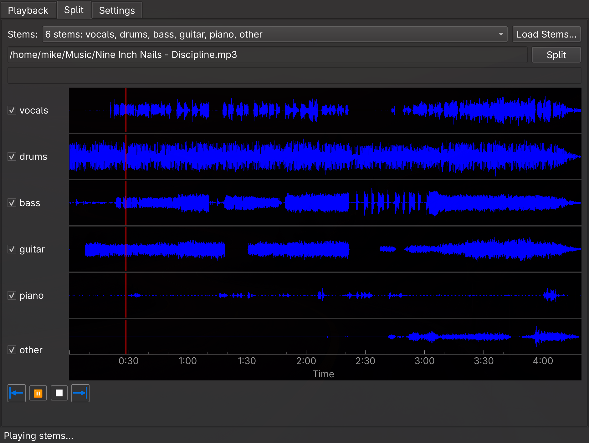

# audio-splitter

Open an audio file, see it as a waveform, listen to it, and split it into stems with
[Demucs](https://github.com/adefossez/demucs): vocals, drums, bass, guitar, piano and other (or
4 stems, or just vocals plus everything else). Each stem gets its own waveform and an on/off
toggle, and the enabled stems play together, so you can mute the guitar or solo the drums.



*"Discipline" by Nine Inch Nails, from The Slip (CC BY-NC-SA 3.0 US), split into six stems.*

Target platform: Arch Linux (Omarchy). Other systems are not supported.

## Install

```
git clone <this repository>
cd audio-splitter
./install.sh
```

Run it as your normal user. It asks for your password (sudo) only if a system package is
missing. It installs what is needed (ffmpeg, a few libraries, `uv`), builds a private
Python 3.12 environment, installs the Python packages (PyTorch CPU build) and downloads the
Demucs models, so the first split works at once. It needs about 1.5 GB of disk space (the
environment is about 1.3 GB, the two models about 140 MB) and a network connection; later
runs are quick. You never create or activate an environment yourself.

Then start **Audio Splitter** from the application menu, or run `audio-splitter`
(`~/.local/bin` must be on your PATH for the second). `audio-splitter song.flac` opens a file
straight away.

Re-run `./install.sh` after pulling changes to update. Your settings are kept.

## Using it

- **Playback** tab: *Load from File* (flac, wav, ogg, mp3), then play, seek by clicking or
  dragging the waveform, stop, or jump to the start or end.
- **Split** tab: choose how many stems (6, 4 or 2), press *Split*, and watch the progress bar.
  A 3-minute song takes about 35 seconds on a recent CPU. The stems appear as rows; untick a
  row to leave it out of playback. Loading a file that was split before shows its stems at once;
  *Load Stems…* opens any other folder of stems.
- **Settings** tab: the audio and stems folders, how long to wait for a song's stems to load, and
  the logging level. Press *Save* to apply them.

Stems are saved as FLAC in `~/Music/audio-splitter/stems/<model>/<song>/`.

## Where things go

| What | Where |
|---|---|
| Stems | `~/Music/audio-splitter/stems` |
| Program, settings (`config.json`), logs | `~/.local/share/audio-splitter/app` |
| Private Python environment | `~/.local/share/audio-splitter/venv` |
| Launcher, menu entry | `~/.local/bin/audio-splitter`, `~/.local/share/applications/` |
| Demucs models | `~/.cache/huggingface` |

The stems folder, the folder the Open dialog starts in, and how long the app waits for a song's
stems to load (60 seconds by default; raise it for very long songs) can be changed on the
Settings tab.

## Uninstall

```
./install.sh --uninstall
```

Removes the program, environment, launcher and menu entry. Your stems and the downloaded
models are kept.

## Options

`./install.sh --help` lists them: `--prefix DIR` installs somewhere other than `~/.local`,
`--no-system-packages` skips the pacman step.

## Licence

audio-splitter is free software under the GNU General Public License, version 3 or later (see
`LICENSE`). It uses PyQt6, which is GPL v3. The Demucs code is MIT. The Demucs models are not part
of this repository: the installer downloads them from their upstream source, and they are subject
to their own terms.

## Development

See `CLAUDE.md`. Developers run from a checkout with their own `.venv` instead.
The project history is in `CHANGELOG.md`.
